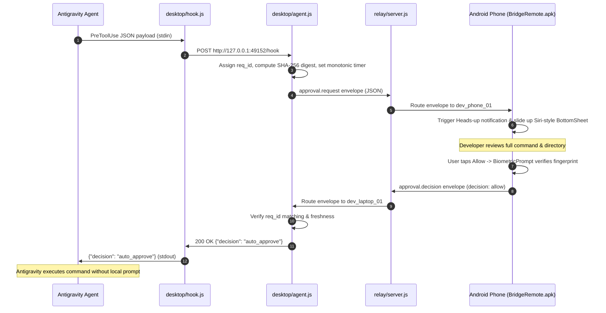

# Bridge Remote

Bridge is an out-of-band remote approval companion and telemetry control system for AI coding agents (specifically Google Antigravity). When an agent requests terminal execution permission, Bridge routes the command to an Android smartphone over an outbound WebSocket relay, presents a biometric-gated approval card, and transmits the decision back to unblock the agent. It also provides basic remote laptop actions: Windows screen locking, desktop screen snapshotting, process monitoring/termination, and hardware telemetry.

---

## 1. Problem

Autonomous coding agents (Antigravity CLI `agy`, IDE, and desktop applications) pause execution whenever tool policy requires user confirmation for shell commands (`run_command`). If the developer steps away from the workstation:

1. **Unattended Execution Freezes:** The agent halts at the terminal permission prompt until physical user interaction occurs.
2. **Insecure Workarounds:** Developers frequently bypass safety boundaries by enabling `--dangerously-skip-permissions` or permissive auto-mode, creating high risk of destructive command execution.
3. **Inbound NAT / Network Inaccessibility:** Laptops behind mobile hotspots, CGNAT, or local firewalls cannot receive inbound connections without complex infrastructure.

Bridge solves this by establishing bidirectional, outbound-only WebSocket connections from both the laptop and phone to a central relay, forwarding permission requests and returning cryptographically bound or biometric approvals within seconds.

---

## 2. Architecture

```
┌────────────────────────────────────────────────────────┐
│                      LAPTOP                            │
│  Antigravity (CLI / IDE / App)                         │
│       │ (PreToolUse stdin JSON)                        │
│       ▼                                                │
│  [desktop/hook.js] (Short-lived CLI client, <50ms)     │
│       │ (Local HTTP IPC: 127.0.0.1:49152)              │
│       ▼                                                │
│  [desktop/agent.js] (Background daemon)                │
│       • Enforces monotonic request timeouts            │
│       • Computes canonical SHA-256 command digest      │
│       • Executes native Windows system actions         │
└───────────────────────┬────────────────────────────────┘
                        │ Outbound WebSocket (/v1/connect)
                        ▼
       ┌─────────────────────────────────┐
       │   [relay/server.js] (Node.js)   │
       │   • Port 8765                   │
       │   • In-memory routing & queue   │
       │   • Device presence tracking    │
       └──────────────┬──────────────────┘
                      │ Outbound WebSocket (/v1/connect)
                      ▼
┌────────────────────────────────────────────────────────┐
│                   ANDROID PHONE                        │
│  [BridgeRemote.apk] (Native Android 8.0+)              │
│  • OkHttp WebSocket connection manager                 │
│  • Heads-up notifications (IMPORTANCE_HIGH)           │
│  • Siri-style half-screen BottomSheet modal            │
│  • Hardware BiometricPrompt (Fingerprint / Face)       │
│  • Remote task and hardware telemetry dashboard        │
└────────────────────────────────────────────────────────┘
```

### Data & Execution Flow (Approval Lifecycle)



### Module Responsibilities

| Module | Primary File(s) | Language / Tech | Responsibilities |
|---|---|---|---|
| **Cloud Relay** | `relay/server.js` | Node.js (`ws` 8.18.0) | Bidirectional message hub, pairing tickets (`/v1/tickets`), connection state tracking, offline queueing. |
| **Desktop Agent** | `desktop/agent.js` | Node.js | Outbound relay link, local IPC server on port 49152, request state machine, approval timeouts. |
| **System Controller** | `desktop/system_controller.js` | Node.js + Windows API / PowerShell | Screen lock (`user32.dll`), process listing with window titles, process termination, battery telemetry, screen snapshot. |
| **Hook Client** | `desktop/hook.js` | Node.js | Intercepts `PreToolUse` events on stdin, communicates with desktop agent, formats JSON response to stdout. |
| **Unified Launcher** | `desktop/run_all.js` | Node.js | Sequentially bootstraps Relay and Desktop Agent in one runtime. |
| **Android App** | `android/` | Java 17, Android SDK 34 | OkHttp WebSocket client, notifications, Siri-style bottom sheet, hardware biometrics, remote control dashboard. |

---

## 3. Core Capabilities

### 3.1 AI Agent Permission Bridge
* **`PreToolUse` Hook Interception:** Intercepts Antigravity tool calls (`run_command`) on `stdin`.
* **Decision Semantics:**
  * Phone **Allow** $\rightarrow$ returns `{"decision": "auto_approve"}` (suppresses local prompt and executes).
  * Phone **Deny** $\rightarrow$ returns `{"decision": "deny", "reason": "Denied remotely from mobile phone"}` (blocks execution).
  * Disconnect / Timeout / Error $\rightarrow$ returns `{"decision": "allow"}` (fail-safe pass-through: Antigravity falls back to local prompt on the laptop screen).
* **Hardware Biometric Gesture:** Android `BiometricPrompt` gates the `Allow` trigger with hardware fingerprint or face authentication.

### 3.2 Active Applications Manager
* **Process Inspection:** Queries active desktop applications with visible windows using PowerShell `Get-Process | Where-Object { $_.MainWindowTitle -ne '' }`, filtering out background OS processes (`svchost.exe`).
* **Resource Telemetry:** Returns application process name, window title, Process ID (PID), and Working Set memory usage in MB.
* **Remote Termination:**
  * **Graceful Close:** Sends `CloseMainWindow()` via PowerShell, giving the application an opportunity to save state.
  * **Force Kill:** Executes `taskkill /F /PID <pid>` for unresponsive tasks.

### 3.3 Remote Screen Snapshot
* **Desktop Capture:** Captures the primary screen via GDI+ (`System.Drawing`), downscales the image to a maximum width of 1280px (720p), compresses to JPEG format, and encodes to Base64.
* **Network Footprint:** Output image payload is approximately 20 KB to 180 KB, transmitting over WebSocket in under 50ms.
* **Mobile Rendering:** Android client decodes bytes via `BitmapFactory.decodeByteArray` and displays inside an interactive 16:9 view with capture timestamp.

### 3.4 Hardware Telemetry & Remote Lock
* **Screen Lock:** Invokes `rundll32.exe user32.dll,LockWorkStation` to immediately engage the Windows lock screen without requiring elevated administrator privileges.
* **Battery & Power:** Queries `Win32_Battery` via CIM for remaining charge percentage and charging status (`isCharging`).
* **RAM & CPU Metrics:** Reports used memory, total memory, usage percentage, CPU core count, and system uptime.

---

## 4. Empirical Validation & Spike Results

Feasibility experiments were conducted on Windows 11 with Antigravity CLI version `1.5.8`. Full raw outputs are preserved in [`spikes/s01_probe/probe.log`](spikes/s01_probe/probe.log).

| Experiment | Configuration | Observed Behavior | Verdict |
|---|---|---|---|
| **S-01 Auto-Approve** | `PreToolUse` hook returns `{"decision": "auto_approve"}` | Command `echo SPIKE_S01_SUCCESS` executed cleanly without displaying local terminal prompt. | **PASS** |
| **S-01 Deny** | `PreToolUse` hook returns `{"decision": "deny"}` | Execution aborted with `tool call denied by pre-tool hook: Spike S-01 blocked by remote decision`. | **PASS** |
| **S-02 Roundtrip Delay** | 5,000 ms simulated network delay before `auto_approve` | Agent paused gracefully for 5s, received verdict, executed `echo DELAYED_ROUNDTRIP_SUCCESS`. | **PASS** |
| **Desktop Snapshot** | GDI+ capture with 1280px downscaling | Generated valid Base64 JPEG buffer in 1.8s, total payload size 20,036 bytes (~20 KB). | **PASS** |

---

## 5. Technology Stack

| Layer | Component | Version / Library |
|---|---|---|
| **Desktop Runtime** | Node.js | `v24.15.0` (LTS) |
| **Desktop Scripting** | Windows PowerShell | `5.1` (`user32.dll`, GDI+ `System.Drawing`, CIM) |
| **Host CLI Agent** | Google Antigravity CLI (`agy`) | `1.5.8` |
| **Relay Transport** | `ws` (WebSocket) | `^8.18.0` |
| **Mobile Runtime** | Android OS | Android 8.0 (API 26) through Android 14+ (API 34) |
| **Mobile Build Toolchain** | Gradle / OpenJDK | Gradle `8.9` / OpenJDK `17.0.20` |
| **Android Gradle Plugin** | AGP | `8.4.2` |
| **Mobile UI Components** | Android Material Components | `com.google.android.material:material:1.12.0` |
| **Mobile Biometrics** | AndroidX Biometric | `androidx.biometric:biometric:1.1.0` |
| **Mobile Networking** | OkHttp | `com.squareup.okhttp3:okhttp:4.12.0` |

---

## 6. Repository Structure

```
.
├── .agents/
│   └── hooks.json                  # Antigravity PreToolUse hook configuration
├── android/
│   ├── app/
│   │   ├── build.gradle            # Android application dependencies & SDK levels
│   │   └── src/main/
│   │       ├── AndroidManifest.xml # Permissions (INTERNET, BIOMETRIC, NOTIFICATIONS)
│   │       ├── java/com/sonujangir/bridge/
│   │       │   ├── MainActivity.java           # Tab coordination, BottomSheet, Biometrics
│   │       │   ├── BridgeClient.java           # OkHttp WebSocket lifecycle & action dispatcher
│   │       │   ├── NotificationHelper.java     # High-priority channel & heads-up banner
│   │       │   ├── ApprovalActionReceiver.java # 1-tap notification button listener
│   │       │   ├── ApprovalsAdapter.java       # RecyclerView adapter for pending approvals
│   │       │   ├── AppsAdapter.java            # RecyclerView adapter for running processes
│   │       │   ├── ApprovalItem.java           # Approval data model
│   │       │   └── AppItem.java                # Process data model
│   │       └── res/
│   │           ├── layout/
│   │           │   ├── activity_main.xml               # Main container with 4-tab BottomNav
│   │           │   ├── dialog_approval_bottom_sheet.xml# Siri-style modal bottom sheet layout
│   │           │   ├── item_approval.xml               # In-app approval queue item
│   │           │   └── item_app.xml                    # Running application item
│   │           └── values/
│   │               ├── colors.xml  # Design tokens (Dark slate, emerald green, coral red)
│   │               └── strings.xml
│   ├── build.gradle                # AGP 8.4.2 configuration
│   └── settings.gradle             # Project 'BridgeRemote' definition
├── desktop/
│   ├── agent.js                    # Desktop daemon (Relay client + IPC server)
│   ├── hook.js                     # Antigravity hook handler (<50ms startup)
│   ├── run_all.js                  # Sequentially boots Relay and Desktop Agent
│   ├── system_controller.js        # Windows API bindings (Lock, Apps, Snapshot, Stats)
│   └── test_phone_simulator.js     # Headless test client for validation
├── relay/
│   ├── package.json                # Dependencies ('ws': '^8.18.0')
│   └── server.js                   # WebSocket router & HTTP ticket endpoints
├── spikes/
│   └── s01_probe/                  # Feasibility probe scripts & empirical logs
├── BridgeRemote.apk                # Pre-compiled Android application binary (6.5 MB)
├── start_bridge.bat                # 1-click Windows launcher
└── UI_UX_SPECIFICATION.md          # Comprehensive UI token and screen specification
```

---

## 7. Getting Started

### Prerequisites
* **Windows 10/11** on the workstation.
* **Node.js** `v18.0.0` or higher installed and on `PATH`.
* **Android Device** running Android 8.0 (API 26) or higher.
* To recompile the Android APK from source (optional): **JDK 17** and **Android SDK 34**.

---

### Step 1: Install Dependencies
Run inside the project root:

```bash
cd relay
npm install
cd ..
```

---

### Step 2: Start the Relay and Desktop Agent
Double-click [`start_bridge.bat`](start_bridge.bat) or run from PowerShell:

```powershell
node desktop/run_all.js
```

Expected output:
```text
========================================================
   BRIDGE - Remote Antigravity & Laptop Companion       
========================================================

[1/2] Starting Cloud Relay Server...
 Bridge Cloud Relay listening on port 8765 
 WebSocket: ws://0.0.0.0:8765/v1/connect     
 Health:    http://0.0.0.0:8765/healthz      

[2/2] Starting Desktop Agent...
[Agent] Local IPC server listening on 127.0.0.1:49152
[Relay] Device connected: dev_laptop_01 (desktop)
[Agent] Connected to Cloud Relay as dev_laptop_01
```

---

### Step 3: Install & Configure the Mobile App
1. Transfer [`BridgeRemote.apk`](BridgeRemote.apk) to your Android phone and install it (enable *"Install from Unknown Sources"* if prompted).
2. Open **Bridge Remote** on your phone.
3. Grant Notification permissions when prompted (required for Android 13+).
4. Tap the **Settings** tab.
5. Enter your laptop's network address:
   * **Home Wi-Fi:** `<your-laptop-wifi-ip>:8765` (e.g. `192.168.1.13:8765`)
   * **Cloud / Domain:** `<your-domain-or-tunnel>:8765`
6. Tap **Save & Connect**. The top badge will switch to **● Online (Green)**.

---

### Step 4: Configure Antigravity Hook
Copy the hook configuration to your workspace or global config:

* Workspace configuration: `.agents/hooks.json`
* Global configuration: `~/.gemini/config/hooks.json`

Ensure the hook handler points to `desktop/hook.js`:

```json
{
  "bridge-remote-companion": {
    "enabled": true,
    "PreToolUse": [
      {
        "matcher": "run_command",
        "hooks": [
          {
            "type": "command",
            "command": "node \"C:\\Users\\hp\\Downloads\\REMOSTE\\desktop\\hook.js\"",
            "timeout": 130
          }
        ]
      }
    ]
  }
}
```

---

## 8. Mobile Application Screens

| Tab / View | Features & Interactions |
|---|---|
| **⚡ Approvals** | Real-time queue of pending tool execution requests. Monospace command preview, working directory path, Request ID. Displays red `[Deny]` and green `[Allow (Biometric)]` action buttons. |
| **Siri-Style Bottom Sheet** | Automatically triggered when tapping a push notification. Slides up as a half-screen dark-slate modal with top drag handle. Biometric prompt triggers on `Allow`, transmitting decision to desktop and dismissing sheet. |
| **📱 Active Apps** | Live process manager. Tap `[Refresh]` to query desktop windows. Each entry displays app name, window title, PID, and RAM usage in MB, with `[Close]` (graceful) and `[End Task]` (force kill) controls. |
| **🎮 Controls** | Remote action dashboard. `[Lock Laptop Screen]` triggers Windows `LockWorkStation`. `[Capture]` takes a 720p desktop screenshot (~20 KB) and displays it with a capture timestamp. Hardware card shows battery level, charging status, RAM usage percentage, and CPU core count. |
| **⚙️ Settings** | Target relay host input with `SharedPreferences` persistent storage. Connection diagnostics (Device ID, protocol version). |

---

## 9. Failure Modes & Safety Guarantees

As specified in [`Error Handling and Resilience.MD`](Error Handling and Resilience.MD), Bridge strictly enforces the **Fail-to-Local Policy (I-4 / ADR-007)**:

* **Zero Auto-Approval on Failure:** If the relay server is unreachable, the phone is offline, the network drops, or the request times out (default 120s), Bridge **never** approves the command.
* **Safe Deferral:** All failure states resolve to `defer` (`{"decision": "allow"}` under Antigravity hook semantics), causing Antigravity to fall back to its standard local prompt on the laptop screen.
* **Time Authority:** Deadlines are measured strictly via the desktop agent's monotonic clock (`Date.now()` delta), rendering the system immune to mobile or network wall-clock drift.

---

## 10. Known Limitations

1. **Platform Restriction:** The desktop agent currently targets **Windows 10/11** due to dependency on Windows-specific binaries (`rundll32.exe user32.dll,LockWorkStation`, GDI+ `System.Drawing`, and PowerShell `Get-Process`). Linux (`systemd`/`xdotool`) and macOS (`osascript`) adapters are architecturally defined in [`SYSTEM_DESING.MD`](SYSTEM_DESING.MD) §13 but not yet implemented.
2. **Cellular Inbound NAT:** Mobile carrier networks (Jio, Airtel, etc.) enforce CGNAT, preventing direct inbound connections to `duckdns.org` without a router port-forward or an outbound cloud tunnel. For cellular-to-laptop connectivity outside local Wi-Fi, deploying `relay/server.js` to a free cloud service (Render / Railway) or using Cloudflare Tunnel is required.
3. **End-to-End Encryption Suite:** The production cryptographic suite (Noise `XXpsk3` + XChaCha20-Poly1305) specified in [`PROTOCOL_SPEC.MD`](PROTOCOL_SPEC.MD) §4 is defined in specification documents; the current release runs over TLS/WebSocket clear envelopes.

---

## 11. Building the Android APK from Source

To compile `BridgeRemote.apk` from the command line:

```bash
cd android
# Windows PowerShell
./gradlew.bat assembleDebug

# Linux / macOS
./gradlew assembleDebug
```

The compiled binary will be placed at:
`android/app/build/outputs/apk/debug/app-debug.apk`

---

## 12. License

This project is licensed under the MIT License. See [LICENSE](LICENSE) for details.

