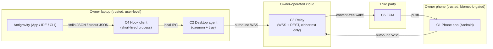
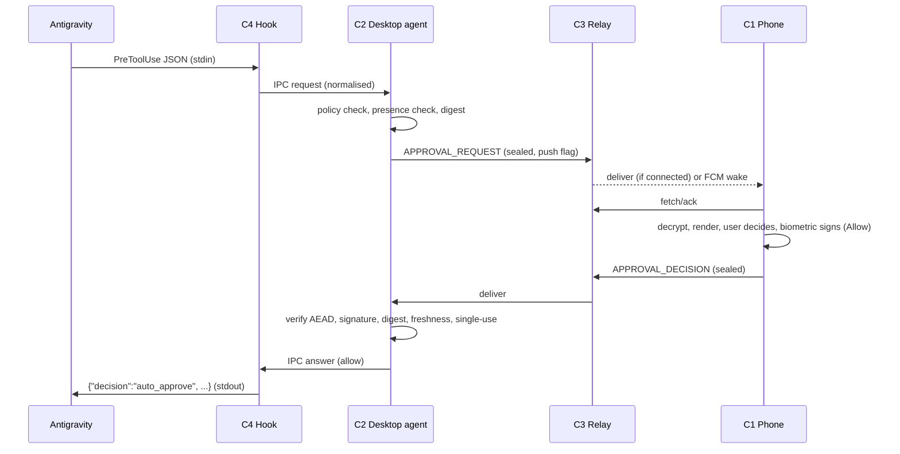
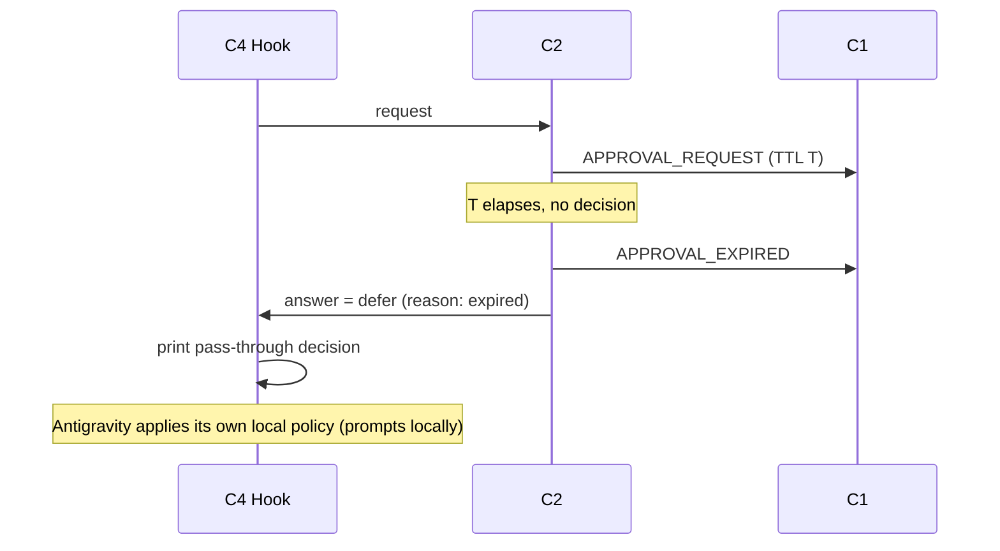
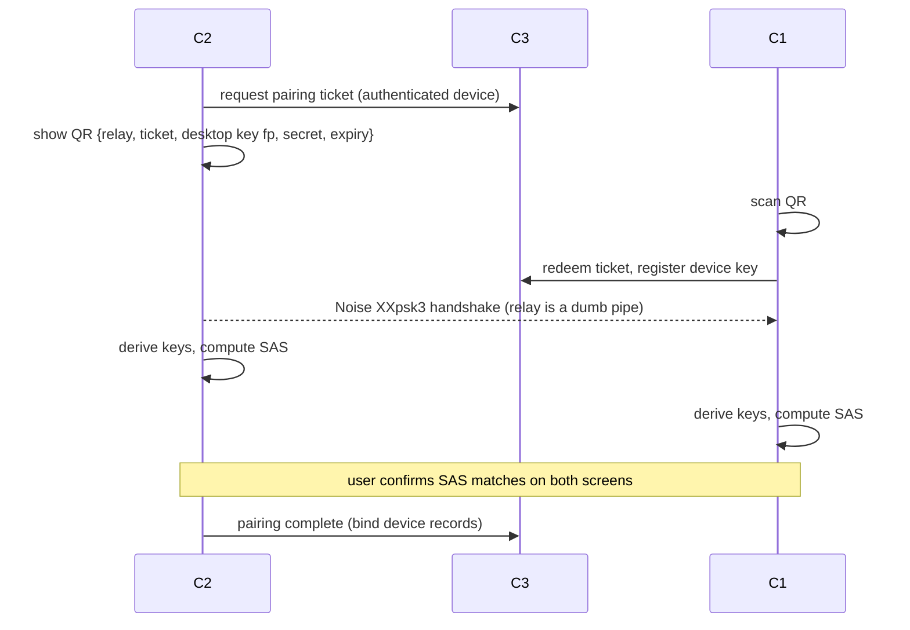
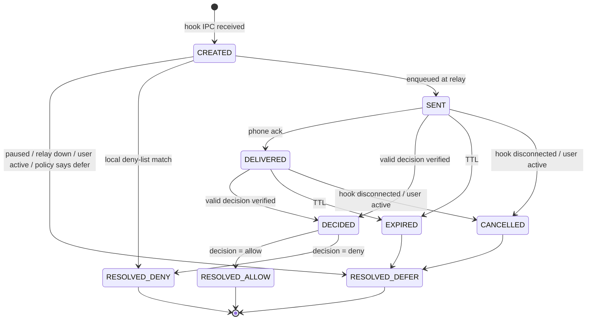

# 02 · System Design

| | |
|---|---|
| **Status** | Draft v0.1, spike-gated (see doc 06) |
| **Date** | 2026-11-13 |
| **Depends on** | 01-PRD, 06-antigravity-integration |

Labels: **[V-DOC]** vendor docs, **[V-3P]** third party, **[ASSUME]**, **[SPIKE-n]**.

---

## 1. Scope

This document defines components, responsibilities, trust boundaries, data flows, state machines, data models, interfaces, deployment and operations for Bridge v1. Wire formats are in 03; security analysis in 04; failure handling in 05; decisions and rejected alternatives in 07.

## 2. Context

Both endpoints dial out; nothing connects inbound to the laptop (ADR-002).

## 3. Components

| ID | Component | Responsibilities | Explicitly NOT responsible for |
|---|---|---|---|
| C1 | **Phone app** (Kotlin, Android) | Pairing (scan QR, SAS), hold keys (Keystore-wrapped), receive/decrypt requests, render approval UI, biometric-gated Allow, send decisions via outbox, notifications, history, device management | Executing anything on the laptop; storing plaintext on the relay |
| C2 | **Desktop agent** (daemon + tray) | Relay connection and reconnect, E2E crypto, request lifecycle state machine and TTL authority, local policy (deny list, tiers), presence detection, action execution from registry, audit log, local IPC server, tray UX, pause/resume | Making allow decisions on its own; talking to Antigravity other than through C4 |
| C3 | **Relay** | Device authentication, routing and short-TTL queueing of opaque ciphertext, presence, push dispatch, pairing tickets, rate limits, revocation enforcement | Reading content; deciding anything; long-term storage of messages |
| C4 | **Hook client** | Invoked by Antigravity per tool call: parse stdin, normalise, call C2 over IPC, translate answer to Antigravity decision JSON, **always** return a valid decision (defer on any error) | State; crypto; networking beyond local IPC |
| C5 | **FCM** | Deliver content-free wake to the phone | Carrying any request content |

## 4. Trust boundaries

| Boundary | Inside is trusted to | Notes |
|---|---|---|
| B1 Laptop user session | Protect keys from other OS users | Same-user malware is out of scope (residual risk R-09) |
| B2 Relay host | Availability only | Treated as **untrusted for confidentiality and integrity** |
| B3 Google / FCM | Delivery only | Sees timing and token, not content |
| B4 Phone | Hold keys; enforce per-use biometric | Lost/stolen phone mitigated by Keystore + revocation |
| B5 The agent itself | Nothing | The command text it proposes is **untrusted input** to the human (prompt-injection risk, doc 04) |

## 5. Primary flows

### 5.1 Approval, happy path

### 5.2 Expiry and local fallback

### 5.3 Pairing (summary; details in 03 §5)

## 6. State machines

### 6.1 Approval request (desktop authority)

Invariants:

* **I-1** Every request reaches exactly one terminal state, and the hook is answered exactly once.
* **I-2** `RESOLVED_ALLOW` is reachable only through `DECIDED` with all verification checks passed (03 §7).
* **I-3** Every transition is written to the audit log before the hook is answered.
* **I-4** Any unexpected condition resolves to `RESOLVED_DEFER`, never to allow.

### 6.2 Relay connection (both clients)

`DISCONNECTED → CONNECTING → AUTHENTICATING → ONLINE → (DEGRADED | DISCONNECTED)`; backoff and jitter parameters in 05 §4. While not `ONLINE`, desktop requests resolve as defer (reason `relay_down`) unless a decision is already in flight.

### 6.3 Bridge mode (desktop)

`ACTIVE ⇄ PAUSED`, plus `SAFE_MODE` entered on key/identity inconsistency (05 F-17). In `PAUSED` and `SAFE_MODE` every request resolves as defer immediately.

## 7. Data model

### 7.1 Desktop (SQLite, WAL)

| Table | Key fields | Notes |
|---|---|---|
| `device` | device_id, role, auth_pubkey, e2e_pubkey, decision_pubkey, state | Own and peer records |
| `session_keys` | peer_id, epoch, k_send, k_recv | Wrapped by OS secure store (A-01: DPAPI) |
| `request` | request_id, digest, state, created_at, ttl_ms, mono_deadline, tool, risk_tier, reason | Plaintext of args is **not** retained after resolution beyond what the audit log needs |
| `seq_state` | peer_id, direction, highest_seq | Replay protection |
| `audit_log` | idx, ts, request_id, event, details, prev_hash, hash | Hash-chained (ADR-015) |
| `config` | key, value | TTL, thresholds, deny patterns, tiers |

### 7.2 Phone (Room/SQLite)

`pending_request`, `history`, `outbox` (decisions not yet acked; persists across process death), `device` (peer keys), `settings`. Private keys never stored in Room; Keystore-wrapped blobs only.

### 7.3 Relay (SQLite, WAL)

| Table | Fields | Retention |
|---|---|---|
| `device` | device_id, role, auth_pubkey, push_token (phone), state, last_seen | until revoked + 30 d |
| `queue` | msg_id, to_device, from_device, size, enqueued_at, expires_at, push_flag, blob | deleted on ack or expiry; hard cap per device |
| `ticket` | ticket_hash, expires_at, used | 5 min |
| `rate` | key, window, count | in memory preferred |

No plaintext, no keys, no command text. Relay loss costs re-pairing, not data (ADR-006).

## 8. Interfaces

### 8.1 Hook ↔ agent (local IPC)

Transport: OS-local, user-only access (A-01: Windows named pipe with ACL restricted to the current user; Unix-like: domain socket mode 0600 in a user-owned directory). Additionally a per-install random token in a user-only file must accompany each request.

Request: `ipc_version`, `hook_event` (normalised fields: tool name, args, cwd, conversationId, stepIdx, optional toolCall id, workspacePaths, modelName), `received_at`.
Response: `decision ∈ {defer, allow, deny}`, `reason_code`, `request_id`. The hook maps `defer → allow` (pass-through), `allow → auto_approve`, `deny → deny` per the vendor contract (doc 06 §3). The agent never returns a free-text reason that includes command content.

If IPC fails for any reason (no agent, bad token, timeout), the hook answers defer (ADR-007, BR-4001).

### 8.2 Relay public interface

* `WSS /v1/connect`: authenticated bidirectional channel for sealed envelopes and presence.
* `POST /v1/tickets`: desktop requests a pairing ticket.
* `POST /v1/tickets/redeem`: phone redeems ticket and registers its keys.
* `POST /v1/devices/{id}/revoke`: authenticated revoke.
* `GET /healthz`: liveness without sensitive data.

Authentication and message schemas: 03. Error codes: 05 §6.

## 9. Deployment

| Piece | Form | Notes |
|---|---|---|
| Relay | Single container on a small VM behind TLS (reverse proxy or built-in), SQLite on a persistent volume, nightly snapshot | Single instance, no HA (ADR-006). Hosting choice open (Q-06). |
| Desktop agent | User-level background process, autostart at login, tray icon | Per-user install, no admin rights needed after install [ASSUME A-01] |
| Hook client | Same binary as agent invoked in "hook" mode, or tiny separate executable | Chosen for cold start (S-10) |
| Phone | Sideloaded signed APK | Release signing key backup is a deliverable (09 M4) |
| Config | `~/.gemini/config/hooks.json` entry named `remote-bridge`, merged not clobbered | Installer must back up and validate (06 §6) |

## 10. Capacity and limits

Single-owner scale makes throughput irrelevant; limits exist for abuse and safety.

| Limit | Initial value | Rationale |
|---|---|---|
| Envelope size | 64 KiB | Commands rarely exceed a few KiB; large pastes rejected with BR-5003 |
| Queue depth per device | 100 | Prevents a runaway agent flooding the phone (BR-5002) |
| Pending approvals per conversation | 10 | Throttle swarm/subagent storms; excess defers locally |
| Requests/minute per device | 60 | BR-5001 |
| Connections per device | 1 active (newest wins) | Ordering and replay simplicity (ADR-013) |

## 11. Observability

* **Desktop**: structured local logs with levels; request ids, state transitions, error codes. No command text at INFO or above; command text only in the audit log, which is local.
* **Relay**: metrics (connections, queue depth, push sent/failed, auth failures, rate-limit hits), structured logs with device ids and sizes only (NFR-08), `/healthz`.
* **Phone**: local diagnostic log, exportable by the user.
* **Alerts** (to the owner): relay unreachable > 10 min while laptop is online; repeated integrity failures (BR-3001/BR-2003/BR-2004); revoked-device connection attempts.

## 12. Versioning and compatibility

Protocol version in every envelope (03 §2). Policy: accept N and N-1; refuse older with BR-7001 and a user-visible upgrade prompt. Hook IPC has its own version. Antigravity compatibility matrix is maintained in doc 06 §8 and enforced by contract tests (TC-I-15).

## 13. Platform adapter (desktop)

Everything OS-specific sits behind one interface so only the adapter changes per OS (NFR-09):

| Capability | Windows (A-01) | Notes |
|---|---|---|
| Lock screen | `LockWorkStation` (user32) | Locking works without elevation [ASSUME, verify in M5] |
| Idle time | `GetLastInputInfo` | Accuracy to be validated, S-09 |
| Session lock events | Session-change notifications | S-09 |
| Secure storage | DPAPI user scope | Protects against other users, not same-user malware |
| Autostart | Per-user startup entry | |
| Tray | Native or cross-platform tray lib | Decided with ADR-010 |

Other OSes: not designed in v1 (Q-01).

## 14. Open design issues

| ID | Issue | Resolves via |
|---|---|---|
| OD-1 | Whether `auto_approve` suppresses the prompt in a mode the owner can live with | S-01 |
| OD-2 | Maximum useful hook timeout, and orphan behaviour when the user cancels the agent run | S-02 |
| OD-3 | Which prompts are visible to the hook (file access outside workspace, MCP, web) | S-03 |
| OD-4 | Multi-hook conflict resolution if the owner has another PreToolUse hook | S-06 |
| OD-5 | Long-poll fallback if WSS is blocked on some networks | S-08 → Phase 4 |